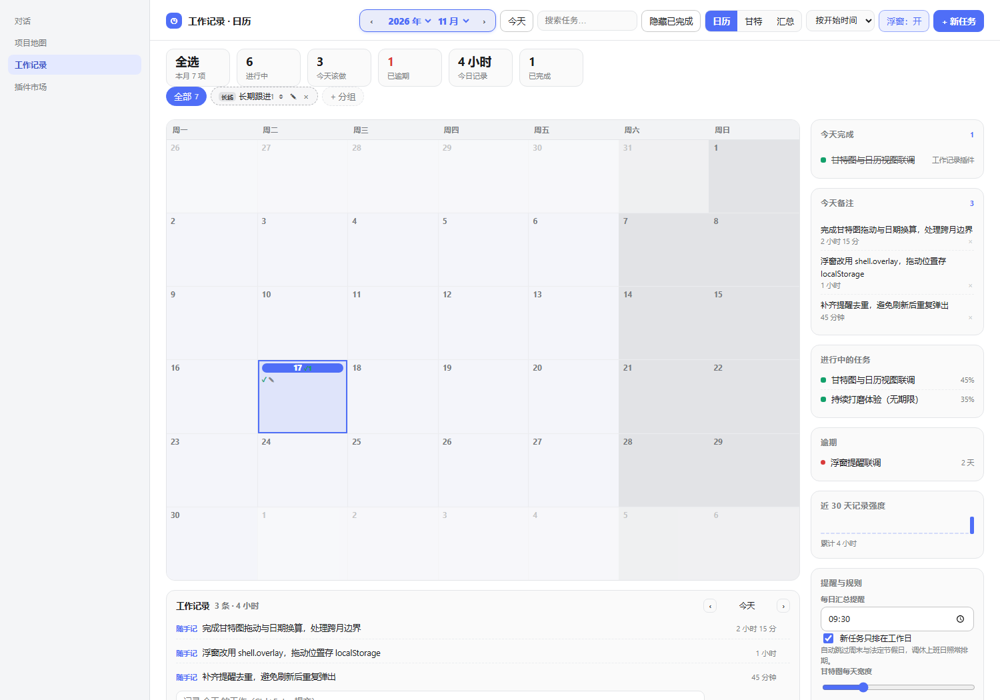
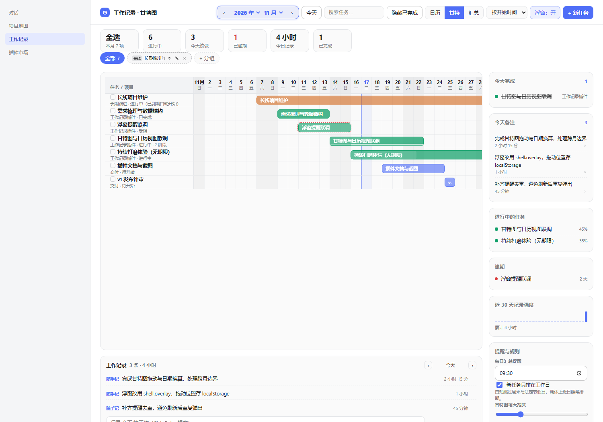
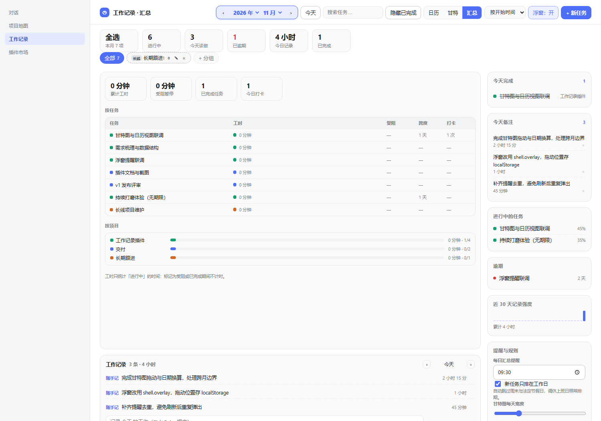
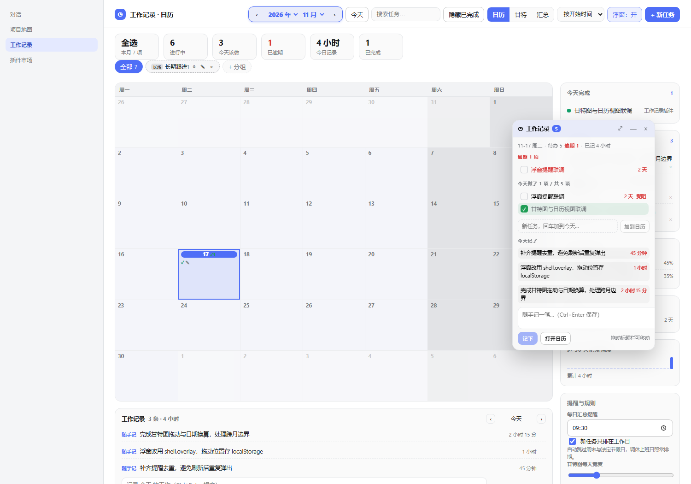

# 工作记录 · 甘特日历（dsh-worklog-calendar）

一款用于 DeepSeek Harness（以下简称 DSH）的插件，把工作任务排在甘特图上、把每天做了什么记录下来，并在任务到点时于右下角浮窗提醒。

插件为单个独立包，无构建步骤、无第三方运行时依赖，浏览器端与宿主端代码都随仓库提供。数据保存在插件目录下的单个 JSON 文件中，卸载或迁移时随目录一并带走。



## 目录

- [功能概览](#功能概览)
- [界面预览](#界面预览)
- [安装](#安装)
- [快速上手](#快速上手)
- [功能说明](#功能说明)
- [给 Agent 使用的工具](#给-agent-使用的工具)
- [数据结构](#数据结构)
- [本地存储](#本地存储)
- [兼容性与依赖](#兼容性与依赖)
- [已知限制](#已知限制)
- [开发与验证](#开发与验证)
- [许可证](#许可证)

## 功能概览

| 能力 | 入口 | 说明 |
| --- | --- | --- |
| 月历视图 | 主面板「日历」标签 | 以打卡表形式呈现每天的任务数量、完成状态与备注痕迹 |
| 甘特视图 | 主面板「甘特」标签 | 横条表示时间跨度，可拖动改期与改时长 |
| 汇总视图 | 主面板「汇总」标签 | 按任务与项目统计工时、受阻时长、跨度与打卡次数 |
| 浮动提醒窗 | 右下角浮窗 | 三态切换（展开、图标、关闭），到点提醒并支持每日汇总 |
| 工作记录 | 浮窗随手记、侧边栏备注区 | 按天记录「今天做了什么」，可附时长与所属任务 |
| 节假日与工作日 | 设置区 | 内置 2025–2027 年放假安排，新任务默认只排到工作日 |
| 分组与项目 | 看板分组条、任务编辑抽屉 | 分组用于切分看板，项目用于归入长期工作流，两者相互独立 |
| 项目阶段 | 任务编辑抽屉 | 记录某个项目在某段时间内交付了什么，并在甘特条上作示意 |
| 批量管理 | 日历与甘特视图勾选框 | 批量改状态、优先级、日期，或归入项目与分组 |
| Agent 工具 | `worklog` 工具 | 让模型直接读写同一份数据，执行排期、记录与查询 |

三种视图共用同一外壳，切换标签时边框、圆角与内边距保持一致，页面不会跳动。

## 界面预览

日历视图以「我哪天做了什么」为信息主线的打卡表：


甘特视图显示完整任务名、项目、状态与实际时间跨度：



汇总视图回答「这段工作到底怎么过的」：



浮动提醒窗与看板同时工作，浮窗可拖动、可收起为图标、可完全关闭：



## 安装

插件遵循 DSH 插件包约定：`package.json` 中的 `dsh.bundle.patch` 声明装载补丁，`dsh.client` 声明浏览器侧模块。以下三种安装方式任选其一。

### 一、从 GitHub 安装

在 DSH 的「插件」页面点击「添加插件」，在「包名或地址」中输入仓库地址：

```
https://github.com/yeloooooooooo/dsh-worklog-calendar
```

也可以填写 pnpm 支持的简写形式 `github:yeloooooooooo/dsh-worklog-calendar`。确认后由插件管理器完成下载、安装与启用。该方式要求本机可以访问 GitHub，并且已安装 Git。

### 二、从本地目录安装

把仓库克隆或下载到任意目录，在「添加插件」中填写该目录的绝对路径。路径必须是绝对路径，相对路径会被拒绝。

### 三、命令行安装

已配置 `dsh` 命令行时，可以执行：

```bash
dsh plugin install https://github.com/yeloooooooooo/dsh-worklog-calendar
```

安装完成后建议重启 DSH，确保浏览器侧模块加载的是新版本。重启后左侧栏出现「工作记录」入口，右下角出现浮动提醒窗。

### 数据文件位置

插件默认把数据写在自身目录下的 `data/worklog.json`，该路径由宿主端根据模块自身位置解析，无需配置，也不依赖当前工作目录。若希望把数据放到别处，可在插件的 `config` 中提供 `stateFile` 绝对路径覆盖默认值：

```yaml
- insert:
    - id: worklog-calendar
      name: 'dsh-worklog-calendar'
      config:
        stateFile: '/path/to/worklog.json'
```

`data/` 目录已在 `.gitignore` 中排除，个人任务与记录不会进入版本库。

### 卸载

在插件页面停用或移除插件即可。数据文件位于插件目录内，移除插件目录会一并删除数据；如需保留，请在移除前把 `data/worklog.json` 复制到其他位置。

## 快速上手

1. 打开左侧栏的「工作记录」。
2. 在日历上点击任意一天，或点击看板右上角的「+ 新任务」。
3. 输入任务名称，选择开始日期。截止日期默认为无期限，需要时再设置。
4. 任务状态、优先级、进度、提醒与备注收在「更多设置」中，按需展开，回车即可创建。

浮动提醒窗第一次出现时会提示开启桌面通知。该授权由浏览器提供，拒绝授权不影响浮窗内的提醒展示。

## 功能说明

### 日历视图

日历是 6×7 的月网格，以周一为一周起始。它是一张完成打卡表，而不是任务清单，每格只显示三类信息：

| 元素 | 含义 |
| --- | --- |
| `✓N` 徽标 | 当天完成的任务数量 |
| 符号 | 按任务颜色着色的完成标记与备注标记 |
| 底色 | 工作日的淡淡底色、周末的较深灰底、法定节假日的淡红底、调休上班日的淡黄底 |

任务名称与备注全文在右侧边栏，随日历上选中的日期切换。这一分工的原因是：月视图填满任务标题后，既看不清哪天最忙，也读不全被截断的文字。

月份切换控件由左右箭头与年、月两个下拉组成，可跨年直接跳转。日期运算基于 UTC 整数天换算，跨夏令时不会出现整体错位一天的情况。

### 甘特视图

横条长度表示任务的起止区间，拖动条形整体改期，拖动两端改时长。无期限任务的条形向右渐隐，表示仍在继续。任务条颜色取自项目标签，深度随完成度变化，并保留最低可辨识深度。

设置了项目阶段的任务，其条形下缘会多出一条分段色带。分段按任务条自身的日期范围定位，超出任务条的部分会被裁掉；阶段用同色半透明细带表示，依靠深浅区分「已完成」「当前阶段」与「超期」。任务仍然只占一行。

### 汇总视图

汇总视图按任务与项目两个维度统计：

| 列 | 含义 |
| --- | --- |
| 工时 | 只在「进行中」期间累计，受阻与已完成期间不计时 |
| 受阻 | 累计被阻塞的时长 |
| 跨度 | 从首次开始到完成（或至今）的日历天数 |
| 打卡 | 该任务累计打卡的天数 |

顶部四张卡片分别显示累计工时、受阻暂停、已完成任务与今日打卡，下方是按项目划分的工时占比条形图。

### 浮动提醒窗

浮窗有三种状态：

| 状态 | 表现 | 进入方式 |
| --- | --- | --- |
| 展开 | 右下角面板 | 点击图标，或看板头部的「浮窗：开」 |
| 图标 | 可拖动圆钮，显示今日待办数 | 面板右上角的收起按钮 |
| 关闭 | 完全不显示 | 面板右上角的关闭按钮 |

浮窗内容按决策所需的信息量排序，依次为：一行概览（日期、待办数、逾期数、今日已记时长）、逾期区（最多 3 条）、今日区（最多 6 条，按「今天截止 → 进行中 → 其余」排序）、最近 3 条工作记录、快速加任务输入框、随手记输入框。

浮窗位置记在浏览器本地。每次渲染都会按当前视口重新钳制坐标，而非只在窗口尺寸变化时修正，因此窗口缩小或页面重新可见后，浮窗不会落在可视区域之外。

### 打卡与任务状态的区别

浮窗中任务前方的勾选框表示「今天做了这件事」，与任务本身的完成状态相互独立：

- 一个跨三周的任务可以连续打卡十五天，而任务本身仍在进行中。
- 打卡会把任务从「待开始」推进到「进行中」。
- 任务标记为「受阻」时仍可打卡，用于记录当天处理了阻塞，但不计入工时。

打卡清单按天独立。每天零点之后，前一天的勾选清空。实现上除定时检查外，还监听页面可见性变化与窗口获得焦点事件，以覆盖「页面开着过夜」与「电脑睡眠」两种绕过定时器的情况。客户端在每次请求中显式携带 `day` 参数，以浏览器看到的日期为准，避免宿主与浏览器时钟不一致导致取到前一天的打卡数据。

### 任务状态

开始是自动的，结束是手动的：

- 到达开始日期后，任务自动显示为「进行中」。
- 完成必须手动标记，程序不会替使用者判定工作已经结束。
- 「受阻」同样需要手动标记，标记期间不计入工时。

### 节假日与工作日

节假日数据来自国务院办公厅每年发布的放假通知，`holidays.json` 内置 2025、2026、2027 三年数据（含调休上班日），每年记录对应的公告链接。数据由 `holiday-cn` 仓库派生，该仓库是上述公告的机器可读副本。

| 年份 | 公告 |
| --- | --- |
| 2025 | [国办发明电，2024 年发布](https://www.gov.cn/zhengce/zhengceku/202411/content_6986383.htm) |
| 2026 | [国办通知，2025 年发布](https://www.gov.cn/zhengce/zhengceku/202511/content_7047091.htm) |
| 2027 | [国办通知，2026 年发布](https://www.gov.cn/zhengce/zhengceku/202611/content_7085102.htm) |

设置面板提供「刷新节假日数据」，会从上游拉取当年与次年的数据。网络失败时保留原有数据，不影响使用。

新任务默认只排在工作日，该行为可在设置中关闭：

- 新建任务未指定日期时，自动落到最近的工作日。
- 自动跳过周末与法定节假日，但调休上班日照常排期。
- 手动指定日期时一律尊重，不擅自改期。

### 分组与项目

项目表示这条任务属于哪个长期工作流，分组表示希望如何切分看板，两者相互独立。任务的归类标签按 `project` → `group` → `未分组` 的顺序取第一个非空值，汇总表按项目统计时使用同一规则。

分组可以标记为「长期跟进」。这类分组从日常视图中退场，但数据完整保留：

| 位置 | 重点分组 | 长期跟进 |
| --- | --- | --- |
| 浮窗打卡清单 | 显示 | 不显示 |
| 日历完成日志 | 计入 | 不计入 |
| 看板进行中与逾期卡片 | 显示 | 不显示 |
| 甘特视图 | 显示 | 显示 |
| 汇总表 | 计入 | 计入 |

已经打卡的长线任务仍会出现在浮窗中，因为这属于对事实的记录，不应被规则隐藏。

### 批量管理

日历与甘特视图中的任务条左侧带勾选框，选中后顶部出现批量操作条，可整批标记完成或重新打开、顺延或提前一天、设为高优先、归入项目、删除。批量操作全有或全无：只要有一个任务 id 不存在，整批不生效并报错，不会出现改了一半的状态。

### 任务颜色

颜色全自动分配：按「项目 → 分组 → 未分组」的顺序取标签，同一标签始终同色，不同标签保证不同色。取色按标签首次出现的顺序依次分配，不使用哈希，因为哈希会让不同名称撞成同一颜色。日历色点、甘特条与汇总表共用同一套色板，也可以在任务编辑中手动指定颜色覆盖。

所有编辑都在页面内完成，不依赖浏览器原生对话框，因为 Electron 桌面端默认禁用 `window.prompt` 与 `window.confirm`，使用它们会导致按钮点击后没有反应。

### 提醒机制

浮窗是唯一的提醒定时器，每 20 秒检查一次，因此无论当前停留在哪个页面都会触发：

- 到期判定条件为 `now >= remindAt - remindLead`，且不早于提醒时刻前 6 小时，避免冷启动时补发数天前的提醒。
- 去重记录保存在 `localStorage` 中，以「任务 id + 提醒时刻」为键，修改过提醒时间会重新武装。
- 系统通知需要浏览器授权，未授权时仍有浮窗内提示。
- 每日汇总在到达设定时间后当天只发一次。

## 给 Agent 使用的工具

插件注册了一个名为 `worklog` 的模型工具，与界面读写同一份数据，可用于让模型协助排期、记录与查询。

```
worklog { action: "snapshot" }
worklog { action: "task.create", title, start, end, project, status, priority, progress, remindAt }
worklog { action: "task.update", id, progress: 80 }
worklog { action: "task.move", id, delta: 2, edge: "end" }
worklog { action: "task.delete", id }
worklog { action: "task.bulk", ids: [...], op: "complete" | "reopen" | "delete" }
worklog { action: "task.bulk", ids: [...], op: "move", delta: 2 }
worklog { action: "task.bulk", ids: [...], op: "set", status: "doing", priority: "high" }
worklog { action: "record.create", content, minutes, date, taskId }
worklog { action: "checkin.toggle", taskId, date }
worklog { action: "checkin.set", taskId, date, done: true }
worklog { action: "summary" }
worklog { action: "group", groupAction: "create", name: "本周必做" }
worklog { action: "group", groupAction: "rename", from: "旧名", name: "新名" }
worklog { action: "group", groupAction: "delete", name: "本周必做" }
worklog { action: "group", groupAction: "reorder", order: ["本周必做", "等对方回复"] }
worklog { action: "group", groupAction: "focus", name: "长期维护", focus: false }
worklog { action: "phase", phaseAction: "create", taskId, name: "需求调研", start, end, outcome }
worklog { action: "phase", phaseAction: "update", id, outcome: "最终 14 个模块", status: "done" }
worklog { action: "phase", phaseAction: "delete", id }
worklog { action: "config", settings: { digestAt, defaultLead, dayWidth, sortBy, workdaysOnly } }
worklog { action: "holidays.refresh" }
```

约定与边界：

- `start` 与 `end` 为闭区间日历日，格式为 `YYYY-MM-DD`。`end: null` 表示无期限，永远算「今天该做」，不计逾期。
- `task.move` 的 `delta` 是整数天。无期限任务只移动开始日期。
- 删除任务不会删除它的工作记录，记录会保留并脱离任务。
- 删除分组只解绑任务，不删除任务；重命名分组会把组内任务一起带走。
- 返回的 `digest` 分为 `today`、`overdue`、`upcoming` 三组，`stats` 附带近 30 天记录强度。

浏览器端通过 HTTP 接口读写，与工具共用同一套逻辑：`GET /api/worklog-calendar?action=snapshot`，`POST /api/worklog-calendar`，JSON 请求体与工具参数一致。请求体上限为 256 KB。

## 数据结构

`data/worklog.json` 是唯一数据源。写入采用「临时文件加改名」的原子方式，串行执行；文件损坏时会自动备份为 `*.corrupt-<时间戳>` 并从空库启动。

```jsonc
{
  "schema": 1,
  "tasks": [{
    "id": "uuid",
    "title": "甘特图联调",
    "project": "工作记录插件",   // 可为空，展示为「未分组」
    "group": "本周必做",         // 看板分组，可为空，与 project 独立
    "start": "2026-11-10",       // 本地日历日，含当天
    "end": "2026-11-17",         // 含当天；null 表示无期限；倒序会被折回 start
    "status": "doing",           // todo | doing | blocked | done
    "priority": "high",          // low | normal | high
    "progress": 45,              // 0-100；done 恒为 100
    "milestone": false,          // 单日里程碑显示为菱形
    "remindAt": "2026-11-12T09:30",
    "remindLead": 15,            // 提前多少分钟提醒
    "detail": "",
    "createdAt": "…",
    "updatedAt": "…",
    "doneAt": null
  }],
  "records": [{
    "id": "uuid",
    "date": "2026-11-12",
    "minutes": 60,
    "content": "…",
    "taskId": null
  }],
  "checkins": [],
  "groups": [],
  "phases": [],
  "holidays": {},
  "settings": {
    "digestAt": "09:30",
    "defaultLead": 10,
    "floatEnabled": true,
    "sortBy": "start",
    "dayWidth": 26,
    "workdaysOnly": true
  }
}
```

日期一律使用本地日历日（`YYYY-MM-DD`），日期运算基于 UTC 整数天，跨夏令时不会错位。文本字段上限为 2000 字符，超出内容会被截断而非拒绝写入。

## 本地存储

浏览器端只保存与设备有关的界面偏好，业务数据一律在 `data/worklog.json` 中。

| 键名 | 内容 |
| --- | --- |
| `worklog.view.v1` | 当前视图（日历、甘特、汇总） |
| `worklog.month.v1` | 当前锚定月份 |
| `worklog.float.v1` | 浮窗位置与尺寸 |
| `worklog.icon.v1` | 浮窗收起为图标后的位置 |
| `worklog.collapsed.v1` | 浮窗是否收起 |
| `worklog.reminded.v1` | 已触发的提醒记录，用于去重 |
| `worklog.digest.v1` | 当日汇总的触发记录 |

浮窗的开关状态保存在数据文件的 `settings.floatEnabled` 中，因此换设备后保持一致。

插件本身不收集任何信息，也不上报使用数据。唯一的网络请求发生在主动点击「刷新节假日数据」时，请求 `holiday-cn` 的数据副本；其余时间插件处于离线状态。

## 兼容性与依赖

- 宿主端只使用 Node.js 内置模块（`node:fs`、`node:path`、`node:crypto`、`node:url`），没有第三方依赖。
- 浏览器端只 require 宿主提供的 `react`，不打包自己的 React 副本。
- 注册的插槽为 `main`、`sidebar.panellist` 与 `shell.overlay`。
- 已在 DSH 0.2.2-rc.3（Windows 桌面端，Chromium 内核）上逐项实测。
- 停用或卸载插件后，看板、浮窗与工具一并消失，但已经写入的数据文件保持不变。

## 已知限制

- 浮动提醒窗依赖页面处于打开状态。DSH 完全退出时不会提醒，因为它不是独立的系统级闹钟。
- 系统通知需要浏览器授权，拒绝授权后只能在浮窗内看到提示。
- 汇总视图的工时来源于任务状态的时间戳记录，手工修改系统时间可能导致统计异常。
- 内置节假日数据覆盖 2025 至 2027 年。超出该范围且未点击刷新时，只按周末判断工作日。
- 数据为单个 JSON 文件，适合个人使用量级。任务与记录达到数万条时，每次读写会变慢。
- 文件锁机制只在进程内生效。同一份数据文件被两个 DSH 实例同时打开时不保证一致，应避免这种用法。

## 开发与验证

插件没有构建步骤。`client.js` 就是浏览器直接加载的产物，修改后刷新页面即可生效；修改 `index.js`（宿主端）需要重启 DSH。

仓库自带一套离线测试，用最小的 React 适配层与桩化的浏览器对象运行真实组件树与真实宿主逻辑：

```bash
node tests/host.test.mjs      # 宿主端：全部 action、边界值、持久化、损坏恢复、HTTP 契约
node tests/client.test.mjs    # 渲染冒烟：用最小 React 适配层跑真实组件树
node tests/deps.test.mjs      # 依赖审计：memo 闭包的传递依赖是否完整
node tests/module.test.mjs    # 模块装载：复现两阶段 factory 装载契约
node tests/drag.test.mjs      # 浮窗拖动：pointerdown → pointermove → pointerup 全链路
```

版面审计基于预览页生成的结构化标记，检查月网格是否为完整的 6×7、甘特轨道是否有真实像素宽度、浮窗是否落在视口内：

```bash
node tests/preview.mjs calendar && node tests/layout.test.mjs
node tests/preview.mjs gantt
node tests/preview.mjs summary
```

`tests/preview.mjs` 会把渲染结果写到 `tests/preview.html`，该文件已在 `.gitignore` 中排除。设置环境变量 `WL_NO_DOCK=1` 可以不渲染浮窗，便于单独截图看板。

`tools/` 下另有两个一次性脚本：`build-holidays.mjs` 从上游数据集重建 `holidays.json`（在新年份公告发布后运行），`merge-css.mjs` 用于合并重复的样式规则。

目录结构：

```
dsh-worklog-calendar/
├── index.js            宿主端：存储、校验、HTTP 路由、worklog 工具
├── client.js           浏览器端：日历、甘特、汇总、浮窗与提醒引擎
├── cordis.patch.yml    装载补丁
├── holidays.json       节假日数据（2025–2027）
├── icon.svg            插件图标
├── package.json        包声明
├── docs/               README 使用的界面截图
├── tests/              离线测试与预览构建，不参与打包
└── tools/              节假日重建与样式合并脚本
```

`package.json` 的 `files` 字段限定了打包内容，`tests/`、`tools/` 与 `docs/` 不会随插件发布。

## 许可证

MIT，详见 [LICENSE](LICENSE)。
